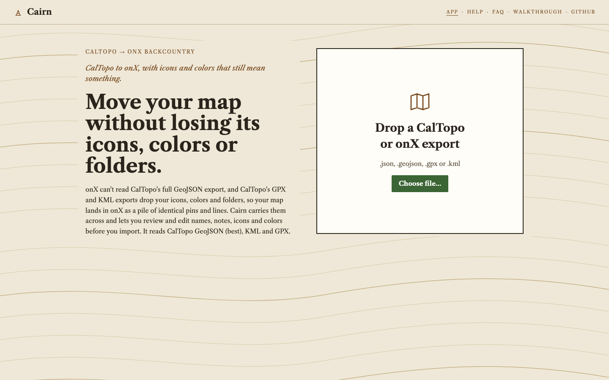
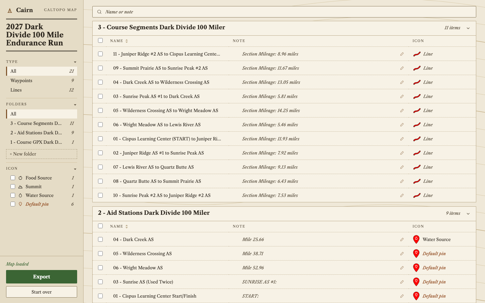
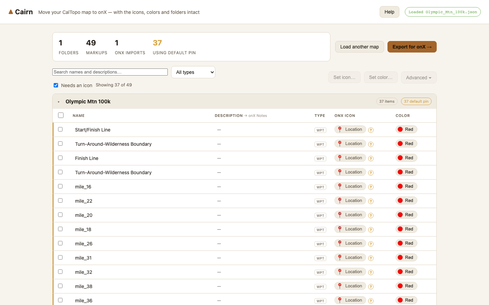
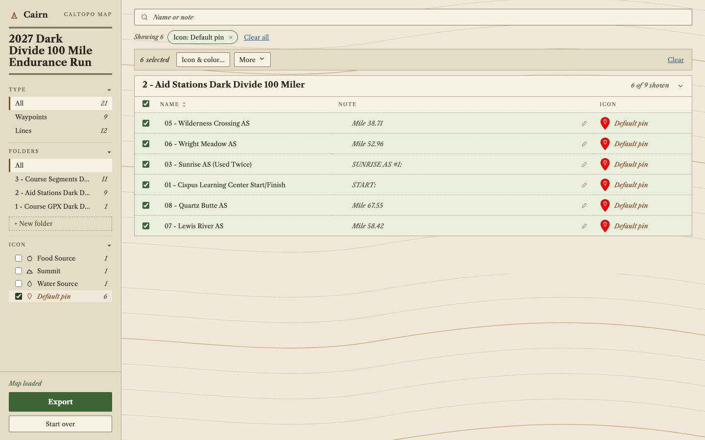
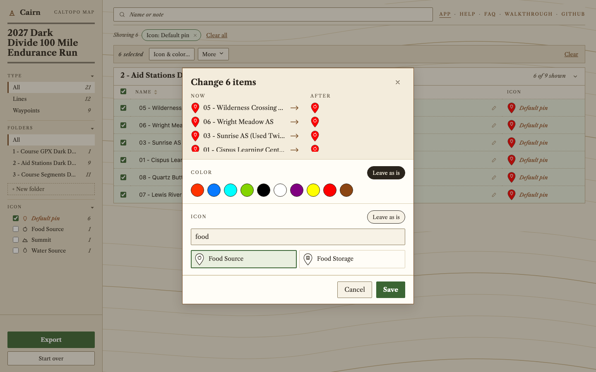
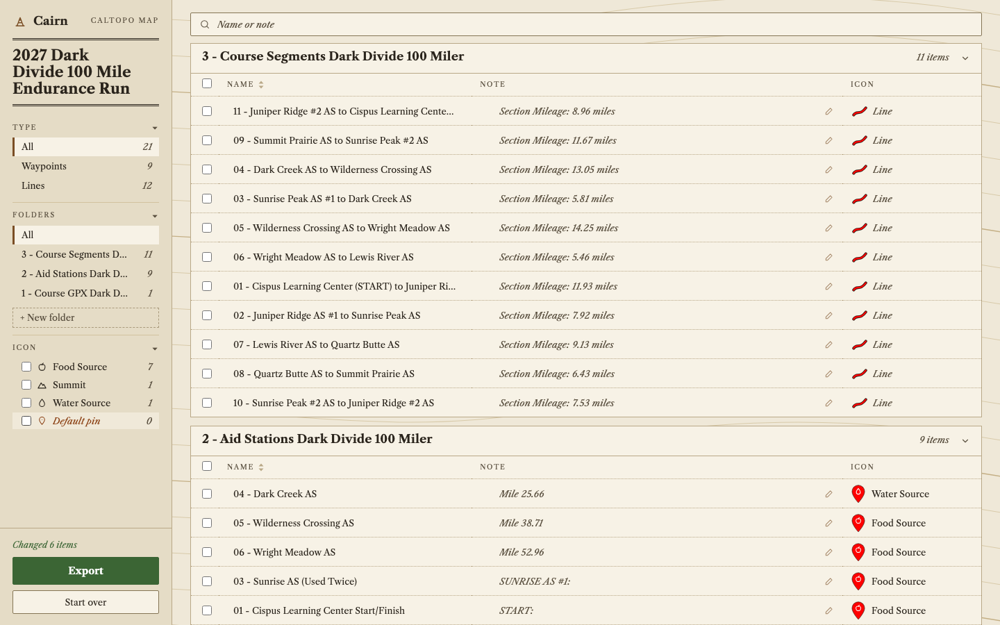
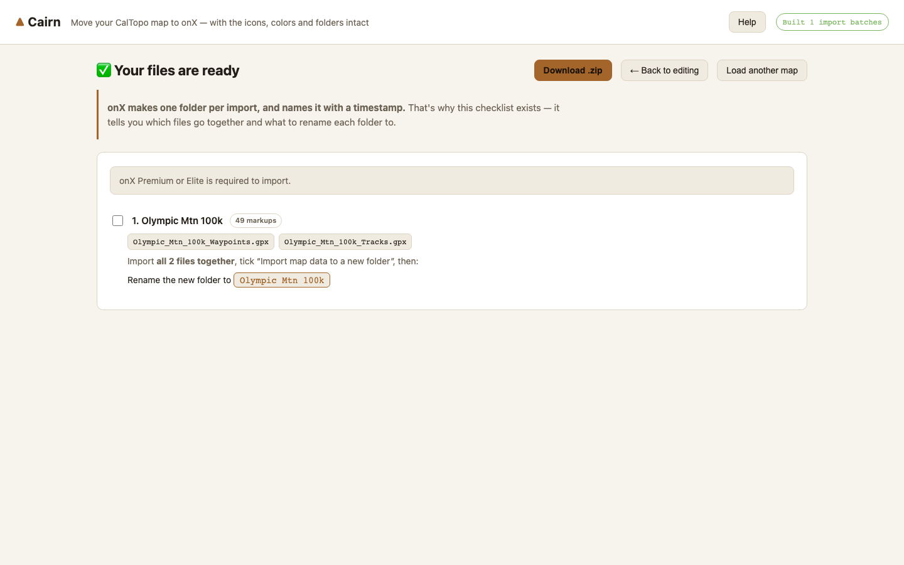
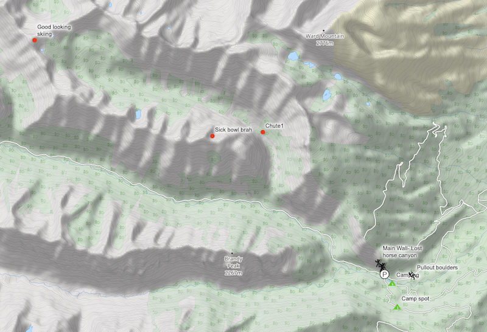
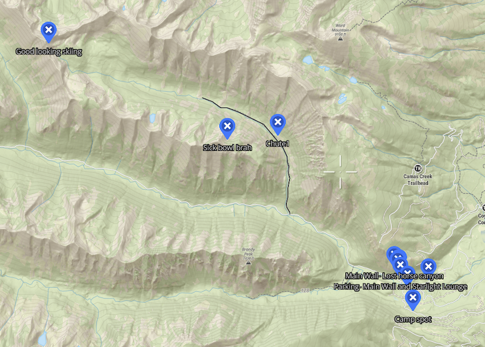
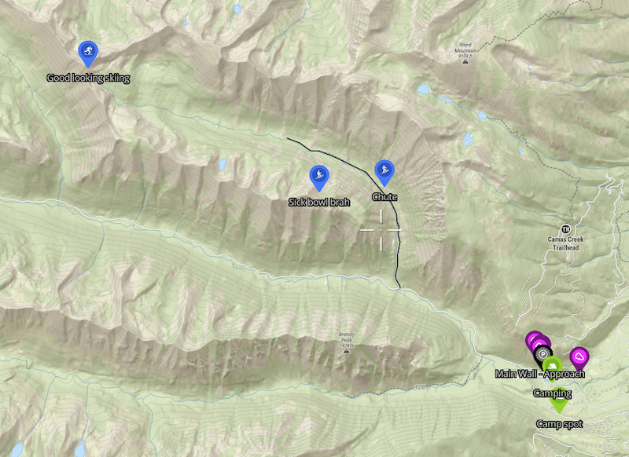

# Cairn

**Work in progress, buyer beware.**

## Try it in the browser

Cairn runs entirely client-side as a web app (the same Python engine, via
[Pyodide](https://pyodide.org)) — your map file never leaves your computer. This is the only
way to use Cairn:

**[quietmarch.to/cairn](https://quietmarch.to/cairn)**

To run it locally instead:

```shell
uv run python web/serve.py   # then open http://127.0.0.1:8765
```

See [`web/README.md`](web/README.md) for how the web app works and
[`docs/VERCEL_DEPLOY_PLAN_2026-08-30.md`](docs/VERCEL_DEPLOY_PLAN_2026-08-30.md)
for how it's deployed.

### A walkthrough

A real transformation, start to finish — a 100k trail race's aid stations, mile splits and
course lines exported from CalTopo as GeoJSON (KML and GPX work too).

**1. Drop the file.** Nothing uploads anywhere; this all runs in your browser.



**2. Review what came in.** 49 markups across aid stations, mile markers and the course lines,
each already given a best-guess onX icon and color.



**3. Filter to what needs a human decision.** 37 waypoints — mostly generic mile markers —
fell back to onX's default pin because nothing in CalTopo matched. That's often fine (a mile
split doesn't need its own icon), but it's a one-click way to see exactly what's still
unresolved.



**4. Select the ones worth fixing.** Here, three mile-marker waypoints.



**5. Set an icon on all of them at once.** No editing one waypoint at a time.



The attention count drops from 37 to 34 — exactly the 3 waypoints just fixed.



**6. Export, and get import instructions, not just a pile of files.** onX creates one folder per
import and names it with a timestamp — never from the filename — so Cairn gives you one box per
folder with its files and a Download button, and the zip carries `instructions.txt`: plain text
naming each folder to rename, its files, and every waypoint, line and area in each.



### Why?

I'm an advocate for open data and being able to exchange map data between platforms. GPX/KML/GeoJSON are meant to be platform-agnostic interchange formats (or at least that's how I understand them). Cairn is my attempt to make that promise feel real for backcountry mapping: move between OnX and CalTopo while taking *all the map customization with you* (icons, colors, notes, and organization), not just raw shapes.

This tool started as an experiment and it surfaced a number of challenges. I'm not an expert — if my assumptions are wrong, I want to find out and correct them. The goal is a faithful migration, not "a file that happens to import."

### So what?

In theory, these formats should make it easy to move between map platforms. In practice, platforms tend to:

- support only a subset of each format
- add non-standard fields or extensions
- rewrite data during import/export (sometimes subtly)

I built Cairn to make migration between systems easier without losing the customization that makes a map valuable: names, notes, colors, icons, and organizational intent. Not just the raw shapes. I have only developed this for onX Backcountry and CalTopo but there are other platforms out there.

### What Cairn does

- 1:1 mapping: Cairn does not decide what you should import or filter anything out. It maps what you give it into what it exports.
- Preview + batch updates: Cairn lets you preview and batch-update waypoint metadata before you generate the GPX you'll import. [[2]](#ref-2) [[3]](#ref-3)
- Works around import constraints: onX documents import constraints and common failure modes. Cairn aims to make those constraints easier to live with. [[1]](#ref-1) [[5]](#ref-5)
  - It automatically splits exports into GPX files under the documented size cap.
  - It writes waypoints and tracks or routes into separate GPX files so they can be imported separately.

### Icon, Symbol and Color Mapping

The real value of Cairn is migrating the stuff that makes a dataset usable in onX: names, descriptions, colors, and icons. onX supports markup options and describes using them when managing saved items. [[2]](#ref-2) [[3]](#ref-3)

Cairn's job is to carry those attributes over so your import doesn't flatten everything into "just points and lines".

#### Why is icon and color mapping important for onX?

onX supports discovery by searching across everything or within a specific content type. However, the only way to filter is by **Color** and **Icon** for waypoints.

Color is a key filtering property in onX's "My Content" feature. When importing waypoints from CalTopo, having colors correctly mapped allows you to:
- Filter large sets of imported waypoints by color and icon
- Quickly find waypoints by combining text + filtering
- Maintain an organizational structure

onX only allows specific colors and icon terms to be used.

See the color reference table below for the allowed onX colors. If the data you want to import provides color information, Cairn will convert it to the closest onX color. If no color is provided then onX will use the default blue.

For icons and symbols, onX accepts a set of ~40 icons but CalTopo exports a much larger set. Even when the icons are visually identical the text labels used may not match and the icon doesn't transfer. When the icon does not match in onX the default  will be used.

Cairn maintains a default mapping of common CalTopo --> onX icons. When it can't map one, the web
app marks that waypoint amber and falls back to onX's default pin — filter to **"Needs an icon"**
to see just those, then set an icon on them (individually or in bulk) before you export. Nothing
is silently dropped; it's just flagged for a quick human decision.

*(Prefer to pre-map symbols permanently instead of fixing them per-export? See
["Custom icon mappings"](#custom-icon-mappings-command-line) under Command line.)*

#### Color reference

There are 10(ish) official OnX colors. Waypoints support **10** colors and Tracks/Lines support **11**, all of the previous 10 plus Fuchsia.

| #  | Color Name   | RGBA Value           | RGB              | Hex                                                                                  | In Waypoints? |
|----|--------------|----------------------|------------------|--------------------------------------------------------------------------------------|---------------|
| 1  | Red-Orange   | `rgba(255,51,0,1)`   | RGB(255, 51, 0)  |  `#FF3300` | ✅ Yes |
| 2  | Blue         | `rgba(8,122,255,1)`  | RGB(8, 122, 255) |  `#087AFF` | ✅ Yes |
| 3  | Cyan         | `rgba(0,255,255,1)`  | RGB(0, 255, 255) |  `#00FFFF` | ✅ Yes |
| 4  | Lime         | `rgba(132,212,0,1)`  | RGB(132, 212, 0) |  `#84D400` | ✅ Yes |
| 5  | Black        | `rgba(0,0,0,1)`      | RGB(0, 0, 0)     |  `#000000` | ✅ Yes |
| 6  | White        | `rgba(255,255,255,1)`| RGB(255, 255, 255)|  `#FFFFFF` | ✅ Yes |
| 7  | Purple       | `rgba(128,0,128,1)`  | RGB(128, 0, 128) |  `#800080` | ✅ Yes |
| 8  | Yellow       | `rgba(255,255,0,1)`  | RGB(255, 255, 0) |  `#FFFF00` | ✅ Yes |
| 9  | Red          | `rgba(255,0,0,1)`    | RGB(255, 0, 0)   |  `#FF0000` | ✅ Yes |
| 10 | Brown        | `rgba(139,69,19,1)`  | RGB(139, 69, 19) |  `#8B4513` | ✅ Yes |
| 11 | Fuchsia      | `rgba(255,0,255,1)`  | RGB(255, 0, 255) |  `#FF00FF` | ❌ No (track-only) |

### Why do this before importing?

onX documents that large markup collections can affect app performance and provides guidance on managing markups. [[4]](#ref-4)

Cairn doesn't change onX's limits. It just helps you arrive with your organization intact.

> "GPX: This is a commonly used file type, you lose line and marker style, and folder organization." [[7]](#ref-7)

### CalTopo GeoJSON, KML or GPX

The web app reads all three CalTopo exports and maps each to onX the same way.

- **GeoJSON** keeps everything CalTopo has.
- **KML** keeps folders, icons, colors, widths, notes and areas. It loses line patterns
  (dashes), and a custom icon's marker color.
- **GPX** keeps names, notes and most line colors (as Garmin color names). It has no folders,
  no icons, no waypoint colors and no areas. You can add icons and colors in Cairn before
  exporting.

The project tests check that the three formats give the same result except for those gaps.
They use one real map exported all three ways
(`tests/fixtures/dark_divide_100/PARITY.md`) and one synthetic map
(`tests/fixtures/caltopo_synthetic/`).

 |  | 

## Development

Cairn is web-only. The Python package in `cairn/` is the conversion engine; the web app runs it
unmodified in the browser via Pyodide. The command-line tool and the Textual TUI it started as
were removed in October 2026 — their last state is the git tag `cli-final`.

```shell
uv sync --all-extras          # once, or after dependency changes
uv run python web/serve.py    # local copy of the web app
uv run pytest                 # add --no-cov for a single file/test — the coverage table only
                              # means something on a full run
```

The web app's end-to-end suite (`tests/web/test_web_app.py`) needs that dev server running and
drives it headlessly; see [`web/README.md`](web/README.md). Engine modules the web app imports
are marked with a `# Web engine:` header, and `tests/test_web_engine_surface.py` keeps that
marking honest.

| | |
|---|---|
| `CAIRN_DEBUG_LOG=<path>` | Opt in to structured debug logging. Off by default. |
| `CAIRN_ICON_CATALOG=<path>` | Opt in to recording which CalTopo symbols you encounter. Off by default. |

## References

<a id="ref-1"></a>
[1] [Importing and Exporting Markups (Waypoints, Routes, Lines, Shapes, and Tracks)](https://onxbackcountry.zendesk.com/hc/en-us/articles/360057195972-Importing-and-Exporting-Markups-Waypoints-Routes-Lines-Shapes-and-Tracks)

<a id="ref-2"></a>
[2] [Editing and organizing Markups (Waypoints, Routes, Lines, Shapes, and Tracks)](https://onxbackcountry.zendesk.com/hc/en-us/articles/360052239052-Editing-and-organizing-Markups-Waypoints-Routes-Lines-Shapes-and-Tracks)

<a id="ref-3"></a>
[3] [Using Markup options](https://onxbackcountry.zendesk.com/hc/en-us/articles/5013855682445-Using-Markup-options)

<a id="ref-4"></a>
[4] [Managing Markups to improve the performance of the onX Backcountry App](https://onxbackcountry.zendesk.com/hc/en-us/articles/4402358311053-Managing-Markups-to-improve-the-performance-of-the-onX-Backcountry-App)

<a id="ref-5"></a>
[5] [There was an error when I imported Markups (Waypoints, Routes, Lines, Shapes, and Tracks)](https://onxbackcountry.zendesk.com/hc/en-us/articles/5022588722317-There-was-an-error-when-I-imported-Markups-Waypoints-Routes-Lines-Shapes-and-Tracks)

<a id="ref-6"></a>
[6] [Transferring your saved items from CalTopo into onX Backcountry](https://onxbackcountry.zendesk.com/hc/en-us/articles/4446611009165-Transferring-your-saved-items-from-CalTopo-into-onX-Backcountry)

<a id="ref-7"></a>
[7] [CalTopo: Exporting Objects](https://training.caltopo.com/all_users/import-export/export)

## License

MIT License - see [LICENSE](LICENSE)
