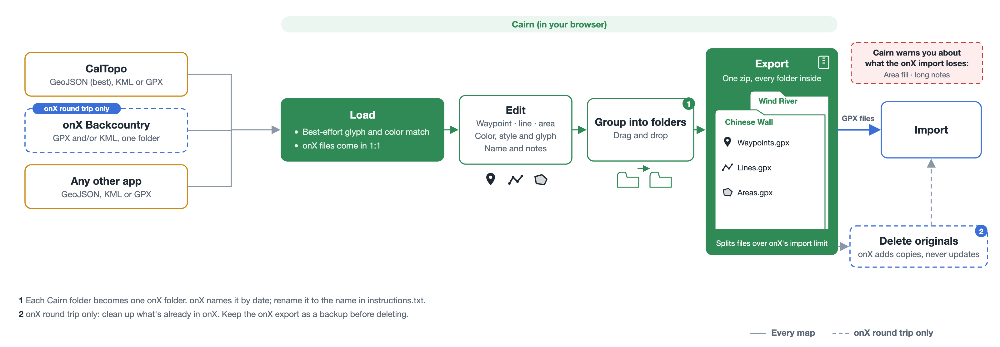

# Cairn

Move a CalTopo map into onX Backcountry and keep its icons, colors, notes and folders.

**[quietmarch.to/cairn](https://quietmarch.to/cairn)** · [FAQ](https://quietmarch.to/cairn/faq) · [Walkthrough](https://quietmarch.to/cairn/walkthrough)

Runs in your browser. Work in progress.

## How it works



## What carries over from CalTopo

| | GeoJSON | KML | GPX |
|---|:-:|:-:|:-:|
| Names, notes | ✓ | ✓ | ✓ |
| Folders | ✓ | ✓ | – |
| Icons | ✓ | ✓ | – |
| Colors | ✓ | ✓ | lines only |
| Dashed lines | ✓ | – | – |
| Areas | ✓ | ✓ | – |

Export GeoJSON from CalTopo when you can.

## Why

GPX, KML and GeoJSON are supposed to make map data portable. In practice each app supports part
of a format, adds its own extensions, and rewrites things on import. Cairn aims for a faithful
move, not just a file that happens to import. If something here is wrong, open an issue.

## Development

```shell
uv sync --all-extras          # once
uv run python web/serve.py    # http://127.0.0.1:8765 (PORT=... to change it)
uv run pytest                 # web tests need the dev server running
```

`cairn/` is the conversion engine, run in the browser by [Pyodide](https://pyodide.org). `web/`
is the app. See [`web/README.md`](web/README.md), [`docs/DEPLOY.md`](docs/DEPLOY.md) and
[`AGENTS.md`](AGENTS.md). The diagram above comes from `scripts/make_readme_diagram.py`. The old
CLI and TUI are at git tag `cli-final`.

## License

MIT. See [LICENSE](LICENSE).
